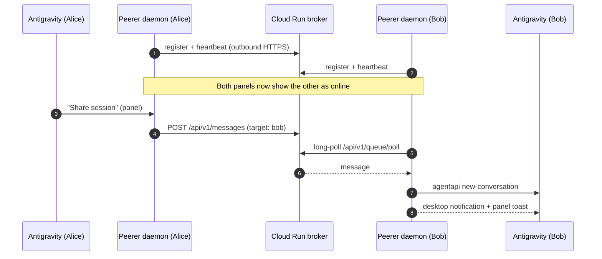

# Peerer

**Peer-to-peer collaboration between Antigravity instances.**
See who's online, chat, and share sessions or data with other Antigravity users — from a panel inside the IDE.

[](https://github.com/benmizrahi/peerer-lab/actions/workflows/ci.yml)
[](https://github.com/benmizrahi/peerer-lab/releases/latest)
[](LICENSE)

---

## What it does

| | |
|---|---|
| **Presence** | A live list of other Antigravity users currently online. |
| **Chat** | Send a message to one peer or broadcast to everyone. It lands as a new conversation (or in an existing one) on their side, delivered through `agentapi`. |
| **Share Session** | One click sends your current conversation ID so a peer can pick up where you are. |
| **Share Data** | Paste a diff, a query, JSON — peers get a copyable card. |
| **Notifications** | Native macOS/Linux desktop notification plus an in-panel toast and unread badge when something arrives, even if the panel is closed. |
| **Settings** | Name (auto-detected from your Antigravity account), server, token, notifications — editable in the panel, applied live. |

Built only on Antigravity primitives — a **sidecar** daemon with an embedded **web UI**, a **skill** so the agent can use it, and `agentapi` for delivery. No third-party agent frameworks.

---

## Install

**One line (macOS / Linux):**

```bash
curl -fsSL https://raw.githubusercontent.com/benmizrahi/peerer-lab/main/peerer-plugin/install.sh | bash
```

**Not a developer?** Download the repo, open `peerer-plugin/`, double-click **`Install Peerer.command`**.
Or just paste into Antigravity chat: *"Install the Peerer plugin from github.com/benmizrahi/peerer-lab"*.

Full guide, including upgrade and uninstall: [`peerer-plugin/INSTALL.md`](peerer-plugin/INSTALL.md)

Then open Antigravity → **Extensions** (puzzle icon, top-right) → **Mesh & Activity**.

---

## Repository layout

```
peerer-lab/
├── peerer-plugin/        The Antigravity plugin (install this)
│   ├── sidecars/peerer/  Always-on daemon + embedded web UI
│   ├── skills/peerer/    Agent skill + CLI scripts (send / peers)
│   ├── bin/peerer        Unified CLI
│   ├── install.sh        One-line installer
│   └── tests/
└── peerer-server/        Optional Cloud Run broker (rendezvous + message queue)
    ├── app/
    ├── deploy.sh
    └── tests/
```

| Component | Docs |
|---|---|
| **Plugin** — what runs on each machine | [`peerer-plugin/README.md`](peerer-plugin/README.md) |
| **Broker** — lets peers behind NAT/firewalls find each other | [`peerer-server/README.md`](peerer-server/README.md) |

---

## How it works



- Peers only make **outbound** connections, so it works behind corporate VPNs and hotel Wi-Fi.
- Without a broker, Peerer still works on a shared LAN via direct HTTP between daemons.
- All broker calls are bearer-token authenticated; tokens live only in your local `config.json` (git-ignored).

---

## Development

```bash
make test          # plugin + server test suites
make install       # link the plugin from this checkout into Antigravity
make release V=1.1.0   # bump version, update CHANGELOG, tag, push → GitHub Release via CI
```

See [`CONTRIBUTING.md`](CONTRIBUTING.md). Security reports: [`SECURITY.md`](SECURITY.md).

## Versioning

Single source of truth: `peerer-plugin/plugin.json → version`. Surfaced via `peerer --version`, the daemon's `/health`, and the panel. Releases follow [SemVer](https://semver.org); history in [`CHANGELOG.md`](CHANGELOG.md).

## License

[Apache-2.0](LICENSE)
